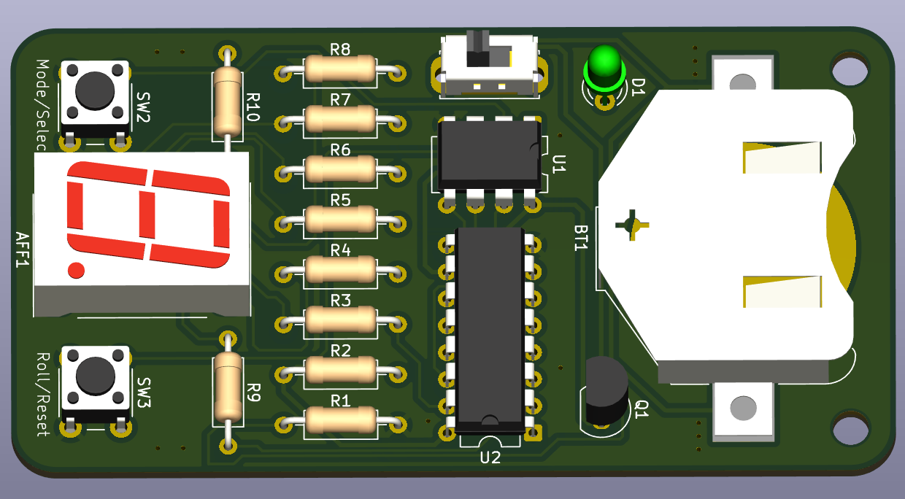
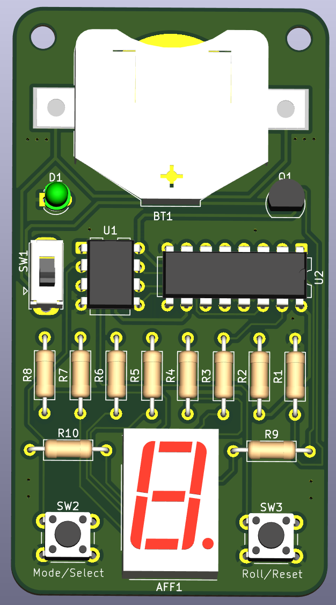
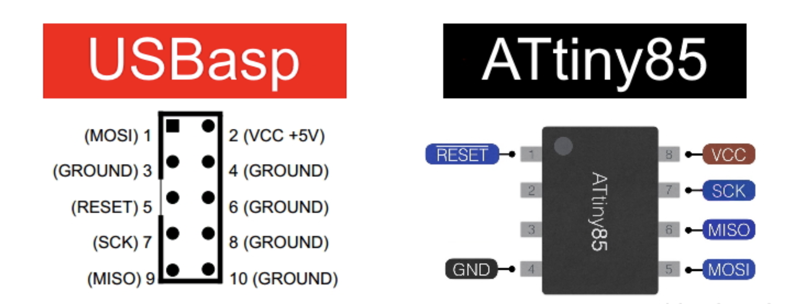

<p align="center">
  
</p>

<h1 align="center">GSAS-LABS </br> P.003-V.1.0.1 </h1>

<p align="center">
  
  
  
  
  
  
</p>

<p align="center">
  Digital dice based on an ATtiny85 and 74HC595. Supports D4, D6, D8, and D10 modes, with configurable rolling animation, button-based type selection, EEPROM persistence, and low-power sleep mode for extended battery life.
</p>

---

# 🎲 Digital Dice

<p align="center">
  
</p>

P.003 is a compact digital dice designed around the ATtiny85 microcontroller.

The project uses a 74HC595 shift register to control the display while minimizing the number of microcontroller pins required.

The dice supports multiple modes and remembers the selected configuration between power cycles.

## Supported Dice

- 🎲 D4
- 🎲 D6
- 🎲 D8
- 🎲 D10

---
# 🎮 How to Use

## Power Switch

The board includes an ON/OFF power switch.

Move the switch to the **ON** position to power the device.

When the board is powered, the power indicator LED turns on, indicating that the circuit is active and ready to use.

Move the switch to the **OFF** position when the device is not being used. Turning the board off helps preserve battery life.

---

## Power Indicator

A dedicated LED indicates the power status of the board.

- **LED ON** — The board is powered and ready to use.
- **LED OFF** — The board is switched off.

For maximum battery life, turn the board off when it will not be used for an extended period.

---

## Buttons

The device includes two buttons:

- **ROLL / RESET**
- **MODE / SELECT**

Both buttons support short and long presses.

### ROLL / RESET

A **short press** rolls the currently selected dice.

The display performs the rolling animation and then shows the generated result.

A **long press** clears the display.

### MODE / SELECT

A **short press** changes the currently selected dice type.

The available dice types are:

```text
D4 → D6 → D8 → D10
```

A **long press** confirms the currently selected dice type.

While selecting a dice type, the led point (`.`) of the 7-segment display is illuminated to indicate that the device is in selection mode.

After confirming the selection with a long press, the decimal point turns off.

The confirmed dice type is remembered by the device and automatically restored the next time the board is powered on.

---

## Dice Modes

The device supports the following dice types:

| Mode | Possible Results |
|---|---|
| D4 | 1 to 4 |
| D6 | 1 to 6 |
| D8 | 1 to 8 |
| D10 | 0 to 9 |

> In D10 mode, the generated values range from `0` to `9`.

---
# 🧾 PCB BOM

<p align="center">
  
</p>

| Reference | Component | Value / Part | Quantity | Purchase Link | Unit Price | Total |
|---|---|---|---:|---|---:|---:|
| AFF1 | 7-Segment Display | Common Cathod  | 1 | [Eletrogate](https://www.eletrogate.com/display-de-7-segmentos-com-1-digito-catodo) | R$ 2.50 | R$ 2.50 |
| BT1 | Battery Holder | BAT-HLD-006-SMT, 1x CR2450 | 1 | [Mouser](https://br.mouser.com/en/ProductDetail/TE-Connectivity-Linx-Technologies/BAT-HLD-006-SMT?qs=sGAEpiMZZMtz8P%2FeuiupSfFU6bUhTAYAC1i0Adw6iu0%3D) | R$ 2.53 | R$ 2.53 |
| D1 | LED | 3 mm Through-Hole LED | 1 | [Eletrogate](https://www.eletrogate.com/led-difuso-3mm-amarelo) | R$ 0.15 | R$ 0.15 |
| Q1 | P-Channel MOSFET | BS250 | 1 | [Aliexpress](https://pt.aliexpress.com/item/1005005545337317.html) | R$ 2.50 | R$ 2.50 |
| R1 | Resistor | 100 kΩ | 1 | [Multcomercial](https://www.multcomercial.com.br/resistor-de-filme-de-carbono-1-4-de-watt-cr25-5-de-tolerancia-0-22r-a-10m.html) | R$ 0.05 | R$ 0.05 |
| R2 | Resistor | 1 kΩ | 1 | [Multcomercial](https://www.multcomercial.com.br/resistor-de-filme-de-carbono-1-4-de-watt-cr25-5-de-tolerancia-0-22r-a-10m.html) | R$ 0.05 | R$ 0.05 |
| R3–R10 | Resistor | 470 Ω | 8 | [Multcomercial](https://www.multcomercial.com.br/resistor-de-filme-de-carbono-1-4-de-watt-cr25-5-de-tolerancia-0-22r-a-10m.html) | R$ 0.05 | R$ 0.40 |
| SW1 | Slide Switch | OS102011MS2QN1C | 1 | [Eletrogate](https://www.eletrogate.com/chave-ss12f46-3-terminais) | R$ 0.50  | R$ 0.50  |
| SW2-SW3 | Push Button | 6 mm Tactile Switch | 2 | [Eletrogate](https://www.eletrogate.com/push-button-chave-tactil-6x6x5mm) | R$ 0.15  | R$ 0.30  |
| U1 | Microcontroller | ATTINY85-20PU, DIP-8 | 1 | [Multcomercial](https://www.multcomercial.com.br/microcontrolador-attiny85-20pu-dip08-cod-loja-5008-atmel.html) | R$ 26.00 | R$ 26.00 |
| U2 | Shift Register | SN74HC595N , DIP-16 | 1 | [Multcomercial](https://www.multcomercial.com.br/circuito-integrado-sn74hc595n-dip-16-cod-loja-2687-texas.html) | R$ 2.52  | R$ 2.52  |

---

## 💰 Estimated Cost

| Item | Estimated Cost |
|---|---:|
| Electronic Components | RS37.50 |
| PCB Manufacturing | TBD |
| **Estimated Total Project Cost** | **TBD** |

> Component prices may vary depending on supplier, quantity, shipping costs, and location.

> PCB manufacturing costs will be added once the board fabrication service and order quantity are defined.
---

# 🛠 Development Environment

The firmware is developed and built using PlatformIO.

The project includes a Makefile that simplifies the most common development tasks.

## Requirements

- macOS
- Homebrew
- PlatformIO

---

# ⚙️ Makefile

The project provides the following commands.

## Install PlatformIO

```bash
make install
```

This command checks whether PlatformIO is already installed.

If PlatformIO is not available, it installs PlatformIO using Homebrew.

## Update PlatformIO

```bash
make update
```

Updates PlatformIO and prints the installed version.

## Build Firmware

```bash
make build
```

## Program ATtiny85 Fuses

```bash
make fuses
```

## Upload Firmware

```bash
make upload
```

---

# 🔌 Programming the ATtiny85

The ATtiny85 is programmed using the ISP protocol.

The required signals are:


<p align="center">
  
</p>


| Signal | Function |
|---|---|
| MOSI | Master Out Slave In |
| MISO | Master In Slave Out |
| SCK | Serial Clock |
| RESET | Programming Reset |
| VCC | Target Power |
| GND | Ground |

The board can be programmed using an ISP programmer such as a USBasp.

## ISP Connection

```text
USBasp              ATtiny85 PCB

MOSI   ──────────── MOSI
MISO   ──────────── MISO
SCK    ──────────── SCK
RESET  ──────────── RESET
VCC    ──────────── VCC
GND    ──────────── GND
```

---

# 🧑‍🔬 GSAS-LABS

GSAS-LABS is an independent engineering laboratory dedicated to the design, development, and exploration of electronics and software projects. It combines hardware and software engineering to create practical projects focused on embedded systems, microcontrollers, PCB design, and software development.

Areas of interest include:

- Embedded systems
- Microcontrollers
- PCB design
- Hardware prototyping
- Electronics
- Software engineering

---

# 📜 License

This project combines software and hardware, with each part released under its corresponding open-source license.

## 💻 Firmware

The firmware is licensed under the [GNU General Public License v3.0 (GPLv3)](https://www.gnu.org/licenses/gpl-3.0.html).

The firmware can be used, studied, modified, and redistributed. Any distributed modifications must remain open-source and be released under the GPLv3.

## 🔧 Hardware

The hardware design is licensed under the [CERN Open Hardware Licence v2 (CERN-OHL-S)](https://ohwr.org/licences/).

This includes the hardware design files, such as:

- Schematics
- PCB layouts
- KiCad project files
- Manufacturing files

The hardware design can be used, studied, modified, manufactured, and distributed. Hardware designs based on this project must preserve the same open and strongly reciprocal principles when distributed.

## 🐧 GSAS-LABS Name and Logo

The **GSAS-LABS name, logo, and visual identity are not covered by the software or hardware licenses**.

All rights to the GSAS-LABS name and logo are reserved by their respective owner.

Use of the GSAS-LABS name or logo does not imply endorsement, affiliation, or approval of derivative projects.

---

<p align="center">
  Made with ❤️ by GSAS-LABS
</p>
